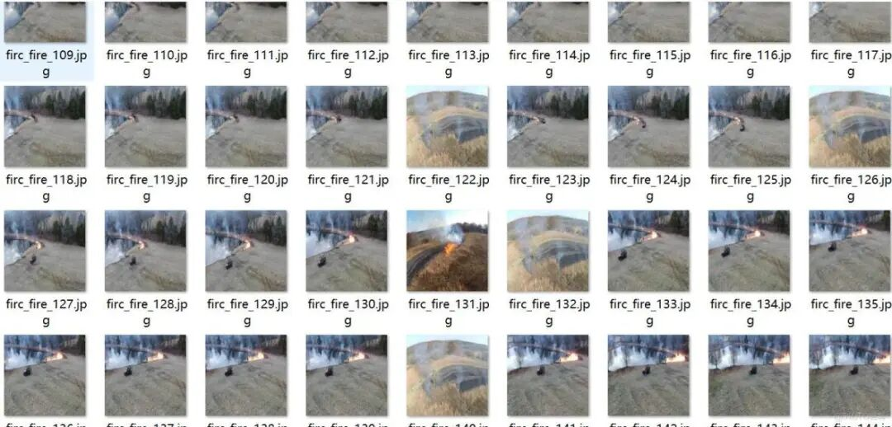
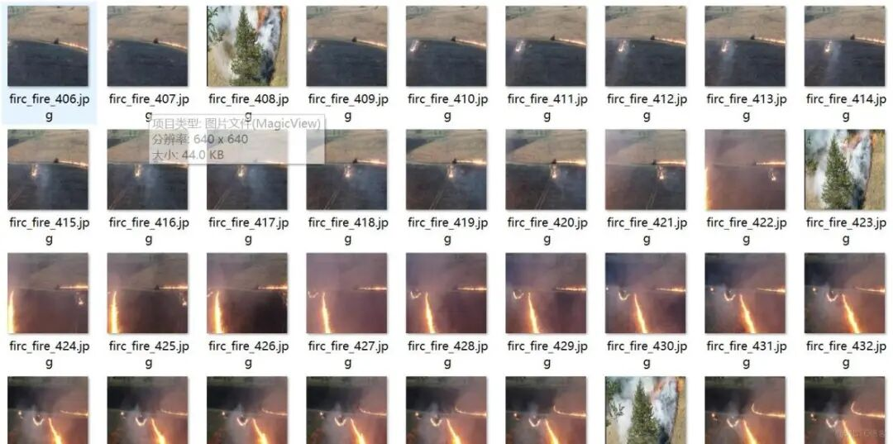
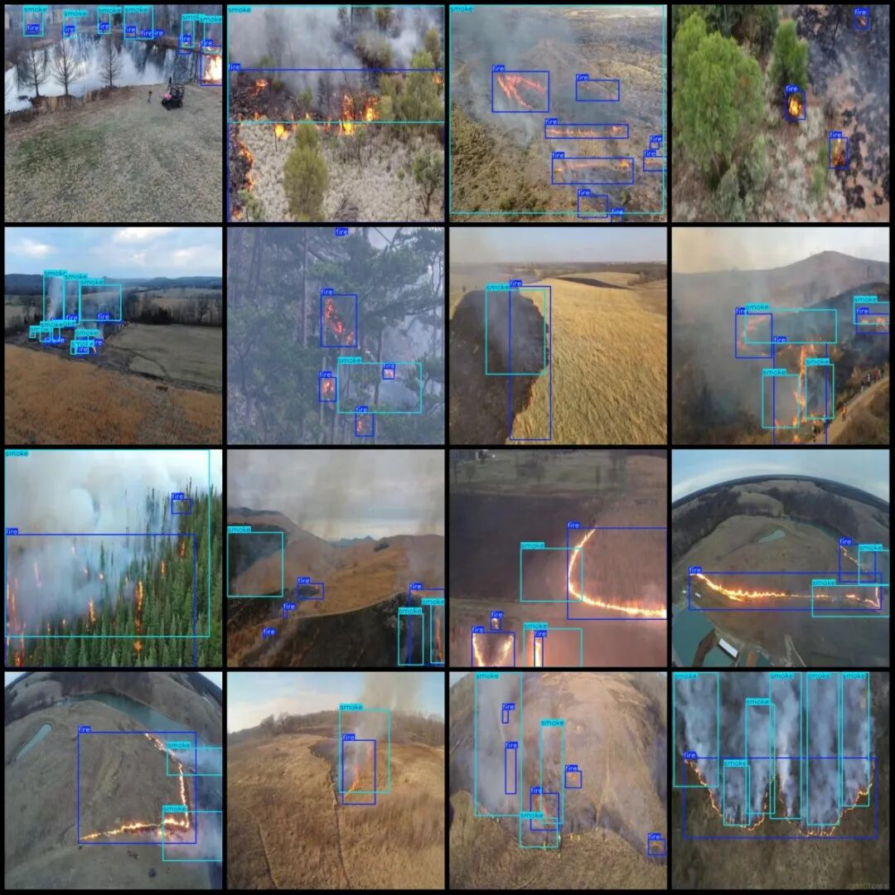
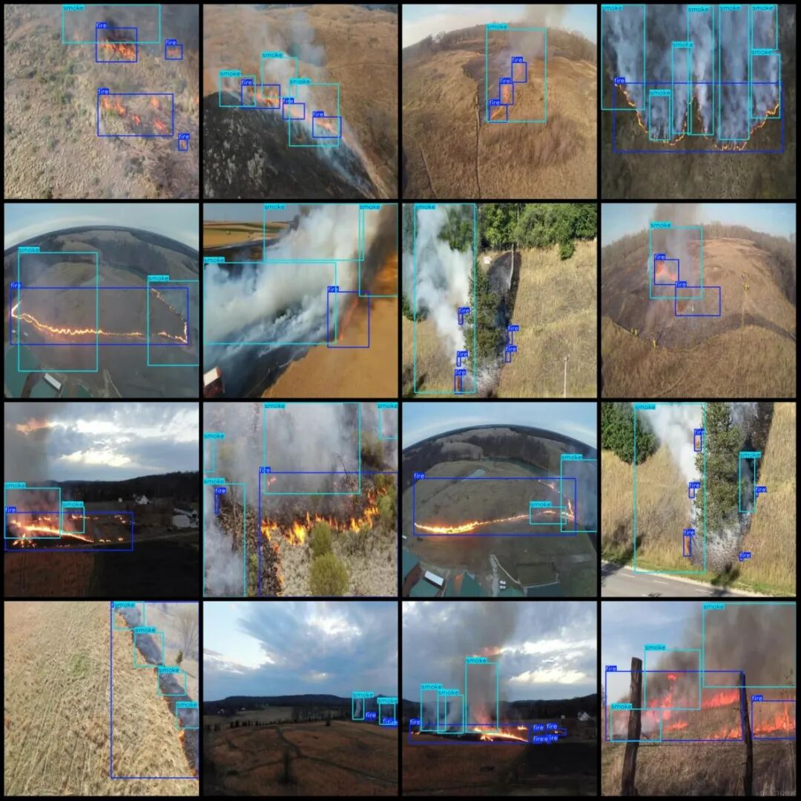

# UAV Perspective Crop Burning Straw Detection Dataset in VOC+YOLO format with 3245 images in 2 categories

The dataset consists of over 20 video frames extracted from more than 20 videos, with annotations for two categories. For details, please refer to the images.

Dataset format: Pascal VOC format + YOLO format (txt file without split path, only containing jpg images and corresponding VOC format xml files and yolo format txt files)

Number of images (number of jpg files): 3245

Number of annotations (number of xml files): 3245

Number of annotations (number of txt files): 3245

Labeling category count: 2

Label category names (Note that the order of categories in the YOLO format does not correspond to this, but is based on the labels folder's classes.txt): ["fire", "smoke"]

Number of boxes labeled in each category:

Fire frame count = 9565

Smoke Frames = 7789

Total frame count: 17354

Image resolution: 640x640

Using labelImg:

Drone: DJI MAVIC 3

Collection height: 20-50m

Sampling angle: 60-90°

Annotation rules: Draw a rectangle around the category.

Important Notice: The dataset does not have separate training, validation, and test sets; you need to partition them yourself.

Special : This dataset does not guarantee the accuracy of the trained models or weight files.

Image Preview:

Annotation example:

## Payment

Here is a pay link on Stripe ( https://buy.stripe.com/3cs8yP7sY87d0vu9AB ). Please contact me lonlonago@foxmail.com after funding $89, and I will send you a complete data files , thank you!

